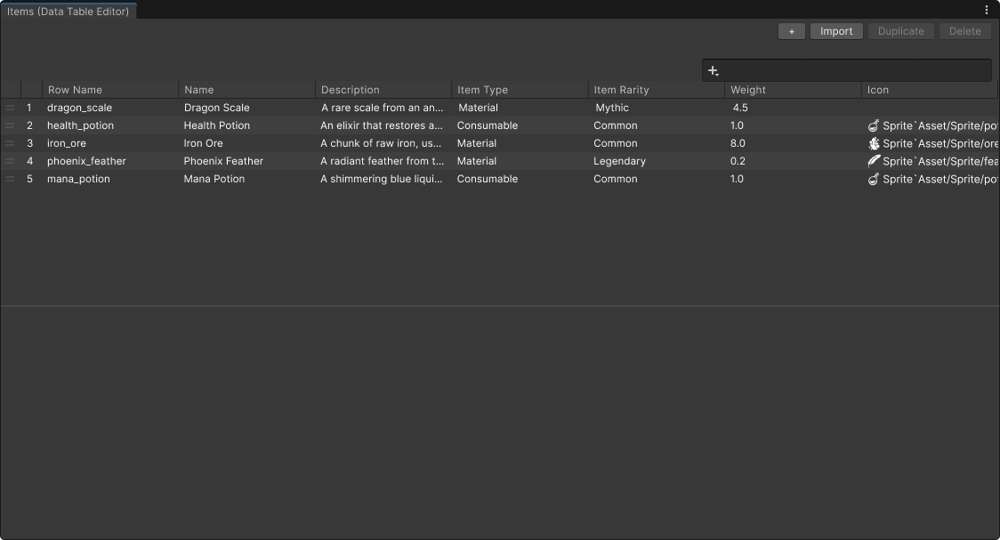
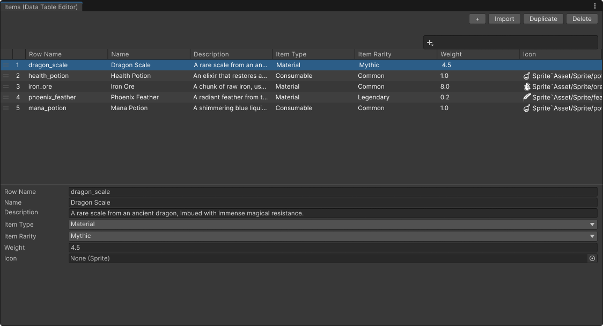

## Table Contents
- [Overview](#overview)
- [Features](#features)
- [Installation](#installation)
- [Guide](#guide)
	- [Create Table Row](#create-table-row)
	- [Create Data Table Asset](#create-data-table-asset)
	- [Open Data Table Editor](#open-data-table-editor)
	- [Using the Data Table Editor](#using-the-data-table-editor)
	- [Saving Changes](#saving-changes)
	- [Working With Data](#working-with-data)
	- [Searching & Filtering](#searching-and-filtering)
	- [Import & Export](#importing-and-exporting)
	- [Accessing Data at Runtime](#accessing-data-at-runtime)
- [Reference](#reference)
- [Known Limitations](#known-limitations)

## **Overview**
**Data Table** is a data management tool for Unity that allows you to define custom data structures using C# and manage rows through a spreadsheet-style Editor Window.<br/>
Each Data Table uses a user-defined `TableRow` type to determine the structure of its rows. You can also configure default field values that are used when creating new rows.<br/>
The custom Editor Window provides an intuitive interface for creating, editing, duplicating, deleting, and reordering rows. It also includes searching, filtering, sorting, multi-row editing, and copy/paste operations with data validation.<br/>

Data Table supports importing and exporting data in CSV and JSON formats and integrates with Unity's Undo system. Multiple Data Table assets can be opened and managed independently through their own editor windows. At runtime, your game scripts can reference Data Table assets to retrieve individual record by row name or find multiple datas using custom conditions. This makes Data Table useful for managing structured game data such as items, characters, equipment, abilities, and other gameplay-related information.

## **Features**
- Undo Support - Seamlessly integrated with Unity's Undo System which allows to revert changes.
- Import/Export - Easily import or export your data in CSV and JSON format.
- Copy/Paste - Copy rows of data. Paste data back to Data table with data validation
- Search Filtering - Search and Filter by value and field-based filter (e.g. item_weight>=20, rarity=Rare, item_name$="Mythril ").
- Sorting - Easily sort by column values in ascending/descending.
- Reordering - Seamlessly reposition row of data through drag and drop or context menu
- Multiple Windows - Open multiple Data Table assets simultaneously.

## **Installation**

### **Requirements**
- Unity 2022.3 or later
- Unity package `com.unity.nuget.newtonsoft-json`

### **Install Dependency**
1. Open `Window > Package Manager`.
2. Click `+` then `Add package by name`.
3. Enter `com.unity.nuget.newtonsoft-json`.
4. Click `Add` and wait for installation to complete.
5. Import `DataTable` unity package if you haven't done so.

## **Guide**
Before continuing, make sure you've completed the [Installation](#installation) steps.
### **Create Table Row**:
-  Navigate to `Assets > Create > Scripting > Data Table > Table Row`:   
```c#
	using System;
	using UnityEngine;
	using BlindGooseStudio.Datatable;
	
	public enum ItemType
	{
		Consumable,
		Material,
		Equipment
	}
	
	public enum ItemRarity 
	{
		Common,
		Uncommon,
		Rare,
		Mythic,
		Legendary
	}
	
	[Serializable]
	public class ItemRow : TableRow
	{
		public string name;
		[Multiline(2)]
		public string description;
		public ItemRarity rarity;
		public ItemType type;
		[Min(0.1)]
		public float weight;
		public Sprite icon;
	}
```

### **Create Data Table Asset**
1. Navigate to `Assets > Create > Data Table`.
2. After creating asset, the `Select Table Row` window appears.<br/>

3. Choose the `TableRow` type you created earlier.<br/>

4. Click `Confirm` to assign the selected row type to the asset.<br/>

> Note: When opening an existing Data Table asset that does not have a row type assigned, the Select Table Row window will appear before the Data Table Editor opens.

### **Open Data Table Editor**
1. Locate your Data Table asset in the Project Window.
2. Double-click the asset to open Data Table Editor.<br/>
 

> Only one Data Table Editor window can edit a particular Data Table asset at a time. Opening an asset that
> is already being edited will focus its existing editor window. Different Data Table assets can be opened in
> separate windows.

### **Using the Data Table Editor**
The Data Table Editor provides a spreadsheet-style interface for viewomg and managing data in you Data Table asset.<br/>
The editor uses assigned row type to the asset to determine the structure of its data. Each row represents an entry, while its data on `row` field of asset is use for intial data entry for new rows.

#### **Table View**
The Table View displays the rows of data. You can select one or multiple rows to perform operations on them.

#### **Context Menu** 
Right-click within the table view or on selected rows to access the context menu operations.<br/>
<br/>
The context menu provides access to operations for mananging rows.

#### **Row Editor**
Select a row to view and edit its properties in the Row Editor<br/>
<br/>
The Row Editor displays the fields defined by the assigned `TableRow` type. You can modify individual values directly through their corresponding property fields.<br/>
When multiple rows are selected, fields with different values are displayed as mixed values. Editing a field allows you to apply the same value to the selected rows.

### **Saving Changes**
Changes made in the Data Table Editor are applied to the asset when you save them.<br/>
Press `Ctrl + S` to save your changes to the Data Table asset.<br/>
The editor also supports Unity's Undo system, allowing you to undo and redo supported editing operations.

### **Working with Data**
The Data Table Editor provides several operations for managing your Data Table.

#### **Adding, Duplicating, and Deleting Rows**
- **Add**: Create a new row in Data Table.
- **Duplicate**: Create a copy of the selected rows.
- **Delete**: Remove the selected rows from Data Table.

You can access the row operations through top-right buttons or context menu.

#### **Reordering Rows**
You can change th order of rows by dragging and dropping handle of row within Table View or by using the context menu.

### **Searching and Filtering**
Use the search field to find specific rows in your Data Table.

You can also use field-based expressions to filter rows according to their values.

Examples:
```text
item_weight>=20
```
or

```text
rarity=Rare
```
or
```text
item_name$="Mythril "
```
Replace the field name and value with those used by your own Data Table.

#### **Sorting**
Sort rows by their column values in ascending or descending order to organize the table view

#### **Copying and Pasting Rows**
You can copy selected rows and paste them into the same or other Data Table with matching schema.

The paste operation validates the copied data against the destination Data Table's row structure. In also support automatic insertion when pasting data.

#### **Keyboard Shortcuts**
| Shortcut | Description |
|---|---|
| `Ctrl + A` | Select all rows. |
| `Ctrl + C` | Copy selected rows. |
| `Ctrl + V` | Paste copied data with validation and automatic insertion. |
| `Ctrl + D` | Duplicate selected rows. |
| `Delete` | Delete selected rows. |
| `F3` | Focus the search field. |
| `Ctrl + S` | Save changes to the Data Table asset. |

### **Importing and Exporting**
The Data Table Editor supports importing and exporting data in CSV and JSON formats.

#### **Importing Data**
1. Open the Data Table asset in the Data Table Editor.
2. Click `Import` button.
3. Select the CSV or JSON file you want to import.

Make sure the imported data is compatible with the row structured assigned to Data Table.

#### **Exporting Data**

1. Select the Data Table asset in Project Window.
2. Right-click the asset to show the context menu.
3. Click the `Export to CSV` or `Export To JSON`.
4. Select the destination for the exported file.

### **Accessing Data At Runtime**
Data Table assets can be referenced from your game scripts and used to retrieve data at runtime.

Assign your Data Table asset to a serialized field, the use `GetRow<T>()` to retrieve a row by its row name

#### **Retrieving a Row**
From example, using the `ItemRow` class created earlier:

```csharp
using UnityEngine;
using BlindGooseStudio.Datatable;

public class ItemDatabase : MonoBehaviour
{
    [SerializeField]
    private DataTable itemTable;

    public ItemsRow GetItem(string rowName)
    {
        if (itemTable == null)
            return null;

        return itemTable.GetRow<ItemsRow>(rowName);
    }

    private void Start()
    {
        ItemsRow healthPotion = GetItem("health_potion");

        if (healthPotion == null)
        {
            Debug.LogWarning("Health Potion was not found in the Data Table.");
            return;
        }

        Debug.Log($"Item: {healthPotion.name}");
        Debug.Log($"Type: {healthPotion.type}");
        Debug.Log($"Rarity: {healthPotion.rarity}");
        Debug.Log($"Weight: {healthPotion.weight}");
    }
}
```

1. Attach the script to a GameObject in your scene.
2. Assign you Data Table asset to the `Item Table` field in Inspector.
3. Use `GetRow<ItemRow>()` or `GetRow()` and provide the row name to retrieve the corresponding data.

`GetRow<T>()` validate itss type if matches its assigned row type then returns the row that matches with row name when it exists, otherwise returns `null`

#### **Finding Rows**
You can also use `FindRows<T>()` to get rows that match a specified condition.

For example, to find all consumable items:
```csharp
var consumables = itemTable.FindRows<ItemsRow>(
    item => item.type == ItemType.Consumable
);
```
This is useful when you need to get list of data that match a particular condition instead of accessing a single row by row name.

## **Reference**
### **Data Table Row Handle**
- `GetRow() or GetRow<T>()` - returns Table Row
- `IsValid()` - returns true if table != null and row name is not empty or null

### **Data Table**
- `this[string rowName]` - Indexer for getting row by row name.
	- `get` - Returns the row if found, else null.
	- `set` - Assigns a row to specified `rowName`. The value must match the table's schema type, otherwise assignment is rejected.
- `Count` - Get the number of rows in the table.
- `Row` – Gets or sets the `TableRow` instance used to define the Data Table's schema and default values. Its type determines the structure of the table, while its field values serve as the initial values for newly created rows.
  > **Note:** Changing the schema is only allowed in the Unity Editor. If the Data Table already contains rows, changing its schema requires confirmation and clears all existing rows.
- `AddRow` - Add a new row to data table using provided string row name and `TableRow` value. The value must match the table's schema type
- `AppendRow<T>` - Add rows of data into data table. if key exist it doesn't add it.
- `GetRows` - Get all the rows in the table regardless of the name.
- `TryAddRow` - Attempts to add row into data table. returns true if row is added, else false if row name already exist.
- `RemoveRow` - Remove row by row name. if row name exist and was removed returns true else false.
- `GetRow` - Get the row by row name. returns if found, else null.
- `GetRow<T>` - Get row by row name and cast it to `T`. returns `T` if the row exists and matches the schema, else null.
- `FindRows` - Finds all rows that match given predicate.
- `FindRows<T>` - Finds all rows that match specified predicate after validating if T matches the table's schema type. if the `T` doesn't match with schema, returns empty `IEnumerable`

## **Known Limitations**
- **Collection fields** - A collections(Array or List) nested inside another collections, since it can't be serialize by unity
- **Asset Deletion** - When asset is deleted it will close any opened editor window that has asset
