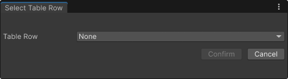
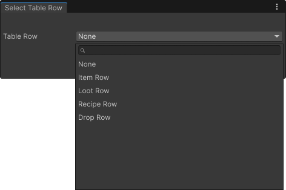
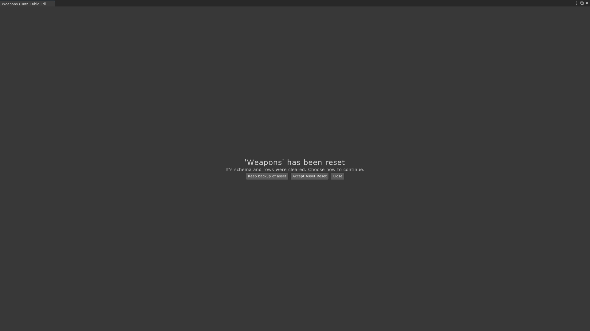
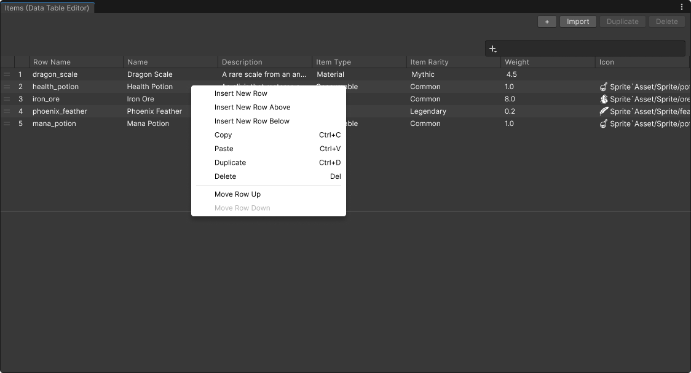
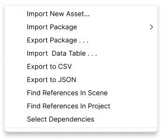
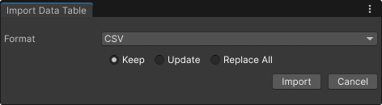
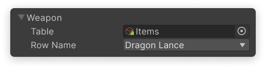

## Table Contents
- [Overview](#overview)
- [Features](#features)
- [Installation](#installation)
- [How Data Table works](#how-data-table-works)
- [Guide](#guide)
	- [Create Table Row](#create-table-row)
	- [Create Data Table Asset](#create-data-table-asset)
	- [Open Data Table Editor](#open-data-table-editor)
	- [When a Data Table Is Reset](#when-a-data-table-is-reset)
	- [Using the Data Table Editor](#using-the-data-table-editor)
	- [Saving Changes](#saving-changes)
	- [Working With Data](#working-with-data)
	- [Searching & Filtering](#searching-and-filtering)
	- [Import & Export](#importing-and-exporting)
	- [Accessing Data at Runtime](#accessing-data-at-runtime)
    - [Referencing Rows in Other Tables](#referencing-rows-in-other-tables)
- [Reference](#reference)
- [Known Limitations](#known-limitations)

## **Overview**
**Data Table** stores structured game data, such as items, enemies, recipes, and abilities, in a
single asset. Define a row type in C#, edit rows in a spreadsheet-style editor, and look rows up
by name or by condition at runtime. There are no per-row assets to manage.

- **One asset per table.** Each Data Table holds its own row type (schema) and every row of data.
- **Typed rows.** Rows are plain C# classes, so you get Unity's standard fields, enums,
  sprites, and attributes, plus compile-time access in code.
- **Built for editing.** Undo/redo, multi-row editing, copy/paste with validation, search and
  field-based filters, sorting, drag-and-drop reordering, and CSV/JSON import and export.
- **Independent windows.** Open as many tables as you like, each in its own editor window.

Data Table adds no toolbar menu: create a table from `Assets > Create > Data Table` and
double-click it to open the editor.

## **Features**
- Undo Support - Integrated with Unity's Undo system, so you can revert changes.
- Import/Export - Import and export data in CSV and JSON formats.
- Copy/Paste - Copy rows and paste them into the same or another Data Table, with validation.
- Search Filtering - Search by value, or filter by field with expressions such as `item_weight>=20`, `rarity=Rare`, or `item_name$="Mythril"`.
- Sorting - Sort rows by column values in ascending or descending order.
- Reordering - Reposition rows through drag and drop or the context menu.
- Multiple Windows - Open multiple Data Table assets at the same time.

## **Installation**

### **Requirements**
- Unity 2022.3 or later
- Unity package `com.unity.nuget.newtonsoft-json`

### **Install Dependency**
1. Open `Window > Package Manager`.
2. Click `+` then `Add package by name`.
3. Enter `com.unity.nuget.newtonsoft-json`.
4. Click `Add` and wait for installation to complete.
5. Import the `DataTable` Unity package if you haven't already.

## **How Data Table works**
1. **Define a row structure**. Create a `TableRow` script (`Assets > Create > Scripting > Data Table > Table Row`).
2. **Create a data table**. Use `Assets > Create > Data Table` and pick your row type. The asset stores an instance of that type as its schema and default values.
3. **Edit rows**. Double-click the asset to add and edit rows in the spreadsheet-style editor. Each new row starts from the schema's default values.
4. **Read rows in code**. Reference the table from any script and look rows up by name or by condition.

## **Guide**
Before continuing, make sure you've completed the [Installation](#installation) steps.
### **Create Table Row**
- Navigate to `Assets > Create > Scripting > Data Table > Table Row`:
```csharp
using System;
using UnityEngine;
using BlindGooseStudio.Datatable;

public enum ItemType
{
    Consumable,
    Material,
    Equipment
}

public enum ItemRarity
{
    Common,
    Uncommon,
    Rare,
    Mythic,
    Legendary
}

[Serializable]
public class ItemRow : TableRow
{
    public string name;
    [Multiline(2)]
    public string description;
    public ItemRarity rarity;
    public ItemType type;
    [Min(0.1)]
    public float weight;
    public Sprite icon;
}
```

### **Create Data Table Asset**
1. Navigate to `Assets > Create > Data Table`.
2. After creating the asset, the `Select Table Row` window appears.<br/>

3. Choose the `TableRow` type you created earlier.<br/>

4. Click `Confirm` to assign the selected row type to the asset.<br/>

> Note: When opening an existing Data Table asset that does not have a row type assigned, the Select Table Row window will appear before the Data Table Editor opens.

### **Open Data Table Editor**
1. Locate your Data Table asset in the Project Window.
2. Double-click the asset to open Data Table Editor.<br/>
 

> **Editor location:** Data Table adds no toolbar menu or tab. Create tables from
> `Assets > Create > Data Table`, then double-click the asset to open its editor, the same way
> Unity's Input Actions asset works. Export is available from the asset's right-click menu.

> Only one Data Table Editor window can edit a particular Data Table asset at a time. Opening an asset that
> is already being edited will focus its existing editor window. Different Data Table assets can be opened in
> separate windows.

### **When a Data Table Is Reset**
Resetting a Data Table from the Inspector clears its row type and all of its rows. If the table's
editor window is open at that moment, the window immediately shows a prompt:



- **Keep backup of asset**: saves a copy of the table as a new asset, then shows the row type
  picker in the same window.
- **Accept Asset Reset**: continues without a backup and shows the row type picker in the same window.
- **Close**: closes the window. The reset has already been applied, so the table stays empty
  with no row type until you open it again and choose one.

If the editor window isn't open when the table is reset, the row type picker appears the next
time you open the table.

> **Tip:** If you reset a table by accident, press `Ctrl + Z` to undo it, or use
> **Keep backup of asset** to keep a copy of the original.

### **Using the Data Table Editor**
The Data Table Editor provides a spreadsheet-style interface for viewing and managing data in your Data Table asset.<br/>
The editor uses the row type assigned to the asset to determine the structure of its data. Each row represents one entry. The asset's `Row` field provides the default values for new rows.

#### **Table View**
The Table View displays the rows of data. You can select one or multiple rows to perform operations on them.

#### **Context Menu**
Right-click within the table view or on selected rows to access the context menu operations.<br/>
<br/>
The context menu provides access to operations for managing rows.

#### **Row Editor**
Select a row to view and edit its properties in the Row Editor.<br/>
<br/>
The Row Editor displays the fields defined by the assigned `TableRow` type. You can modify individual values directly through their corresponding property fields.<br/>
When multiple rows are selected, fields with different values are displayed as mixed values. Editing a field allows you to apply the same value to the selected rows.

### **Saving Changes**
Changes made in the Data Table Editor are applied to the asset when you save them.<br/>
Press `Ctrl + S` to save your changes to the Data Table asset.<br/>
The editor also supports Unity's Undo system, allowing you to undo and redo supported editing operations.

### **Working with Data**
The Data Table Editor provides several operations for managing your Data Table.

#### **Adding, Duplicating, and Deleting Rows**
- **Add**: Create a new row in the Data Table.
- **Duplicate**: Create a copy of the selected rows.
- **Delete**: Remove the selected rows from the Data Table.

You can access the row operations through the top-right buttons or the context menu.

#### **Reordering Rows**
You can change the order of rows by dragging and dropping the row handle within the Table View, or by using the context menu.

### **Searching and Filtering**
Use the search field to find specific rows in your Data Table.

You can also use field-based expressions to filter rows according to their values.

Examples:
```text
item_weight>=20
```
or

```text
rarity=Rare
```
or
```text
item_name$="Mythril"
```
Replace the field name and value with those used by your own Data Table.

#### **Sorting**
Sort rows by their column values in ascending or descending order to organize the table view.

#### **Copying and Pasting Rows**
You can copy selected rows and paste them into the same or another Data Table with a matching schema.

The paste operation validates the copied data against the destination Data Table's row structure. It also supports automatic insertion when pasting data.

#### **Keyboard Shortcuts**
| Shortcut | Description |
|---|---|
| `Ctrl + A` | Select all rows. |
| `Ctrl + C` | Copy selected rows. |
| `Ctrl + V` | Paste copied data with validation and automatic insertion. |
| `Ctrl + D` | Duplicate selected rows. |
| `Delete` | Delete selected rows. |
| `F3` | Focus the search field. |
| `Ctrl + S` | Save changes to the Data Table asset. |

### **Importing and Exporting**
The Data Table Editor supports importing and exporting data in CSV and JSON formats.

#### **Importing Data**
You can import a CSV or JSON file in two ways.

**From the Project window**
1. Select the Data Table asset in the Project window.
2. Choose `Assets > Import Data Table...`.<br/>

3. Select the CSV or JSON file you want to import.
4. Choose how to handle rows that already exist in the table, then click `Import`.<br/>


**From the Data Table Editor**
1. Open the Data Table asset in the Data Table Editor.
2. Click the `Import` button.
3. Select the CSV or JSON file you want to import.

| Mode | Rows already in the table | New rows in the file |
|---|---|---|
| **Keep** | Left as they are | Added |
| **Update** | Updated with the values from the file | Added |
| **Replace All** | Removed before importing | Added |

Make sure the imported data is compatible with the row type assigned to the Data Table.

#### **Exporting Data**

1. Select the Data Table asset in the Project Window.
2. Right-click the asset to show the context menu.
3. Click `Export to CSV` or `Export to JSON`.
4. Select the destination for the exported file.

### **Accessing Data At Runtime**
Data Table assets can be referenced from your game scripts and used to retrieve data at runtime.

Assign your Data Table asset to a serialized field, then use `GetRow<T>()` to retrieve a row by its row name.

### **Referencing Rows in Other Tables**
A `DataTableRowHandle` field lets a row point at a row in another Data Table, for example a weapon
that points at its entry in an items table.

```csharp
[Serializable]
public class WeaponRow : TableRow
{
    public DataTableRowHandle weapon;
    public WeaponType weaponType;
    public int damage;
    [Min(1)]
    public int level;
}
```

In the Row Editor, expand the field, then choose the **Table** and pick the **Row Name** from the dropdown.



A handle stores the row's id, not its name. If you rename the row in the target table, the handle
updates with it and the link keeps working.

To read the linked row in code, check the handle first:

```csharp
WeaponRow sword = weaponTable.GetRow<WeaponRow>("rusty_sword");

if (sword.weapon.IsValid())
{
    ItemRow item = sword.weapon.GetRow<ItemRow>();
    Debug.Log(item.name);
}
```

#### **Retrieving a Row**
For example, using the `ItemRow` class created earlier:

```csharp
using UnityEngine;
using BlindGooseStudio.Datatable;

public class ItemDatabase : MonoBehaviour
{
    [SerializeField]
    private DataTable itemTable;

    public ItemRow GetItem(string rowName)
    {
        if (itemTable == null)
            return null;

        return itemTable.GetRow<ItemRow>(rowName);
    }

    private void Start()
    {
        ItemRow healthPotion = GetItem("health_potion");

        if (healthPotion == null)
        {
            Debug.LogWarning("Health Potion was not found in the Data Table.");
            return;
        }

        Debug.Log($"Item: {healthPotion.name}");
        Debug.Log($"Type: {healthPotion.type}");
        Debug.Log($"Rarity: {healthPotion.rarity}");
        Debug.Log($"Weight: {healthPotion.weight}");
    }
}
```

1. Attach the script to a GameObject in your scene.
2. Assign your Data Table asset to the `Item Table` field in the Inspector.
3. Use `GetRow<ItemRow>()` or `GetRow()` and provide the row name to retrieve the corresponding data.

`GetRow<T>()` checks that `T` matches the table's row type. It returns the row with that row name if it exists, and `null` otherwise.

#### **Finding Rows**
You can also use `FindRows<T>()` to get rows that match a specified condition.

For example, to find all consumable items:
```csharp
var consumables = itemTable.FindRows<ItemRow>(
    item => item.type == ItemType.Consumable
);
```
This is useful when you need a list of rows that match a condition, instead of accessing a single row by its row name.

## **Reference**
### **Data Table Row Handle**
- `GetRow()` or `GetRow<T>()` - Returns the row the handle points to.
- `IsValid()` - Returns true if the handle's table is assigned, a row is selected, and that row
  still exists in the table. Returns false if the table is missing, no row is selected, or the
  row has been deleted.

### **Data Table**
- `this[string rowName]` - Indexer for getting a row by its row name.
	- `get` - Returns the row if found, otherwise null.
	- `set` - Assigns a row to the specified `rowName`. The value must match the table's schema type, otherwise the assignment is rejected.
- `Count` - Gets the number of rows in the table.
- `Row` – Gets or sets the `TableRow` instance used to define the Data Table's schema and default values. Its type determines the structure of the table, while its field values serve as the initial values for newly created rows.
  > **Note:** Changing the schema is only allowed in the Unity Editor. If the Data Table already contains rows, changing its schema requires confirmation and clears all existing rows.
- `AddRow` - Adds a new row to the Data Table using the provided row name and `TableRow` value. The value must match the table's schema type.
- `AppendRows` - Adds multiple rows to the Data Table. If a row name already exists, that row is not added.
- `AppendRows<T>` - Adds multiple rows of type `T` to the Data Table. If a row name already exists, that row is not added.
- `ClearRows` - Removes all rows from the Data Table.
- `GetRows` - Gets all the rows in the table, regardless of their names.
- `TryAddRow` - Attempts to add a row to the Data Table. Returns true if the row was added, or false if the row name already exists.
- `RemoveRow` - Removes the row with the given row name. Returns true if the row existed and was removed, otherwise false.
- `GetRow` - Gets the row with the given row name. Returns the row if found, otherwise null.
- `GetRow<T>` - Gets the row with the given row name and casts it to `T`. Returns `T` if the row exists and matches the schema, otherwise null.
- `FindRows` - Finds all rows that match the given predicate.
- `FindRows<T>` - Finds all rows that match the given predicate, after checking that `T` matches the table's schema type. If `T` doesn't match the schema, returns an empty `IEnumerable`.

## **Known Limitations**
- **Collection fields** - A collection (array or List) nested inside another collection is not supported, because Unity can't serialize it.
- **Asset Deletion** - If a Data Table asset is deleted, any editor window open on it closes.
